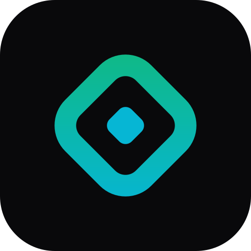

  

<h1 align="center">Zaica Labs</h1>

  Laboratorio experimental de ingeniería de software: apps, juegos y herramientas. 
  <a href="https://zaicalabs.com">zaicalabs.com</a> · <a href="mailto:support@zaicalabs.com">support@zaicalabs.com</a>

  

## Juegos diarios

Un reto nuevo cada día, gratis, en el navegador y sin registro.

| | Juego | De qué va |
|---|---|---|
| 🔐 | [Sigilo](https://zaicalabs.com/games/sigilo/) | Un mensaje cifrado cada día con un método distinto (César, Atbash, Polibio…). |
| 🔗 | [Eslabón](https://zaicalabs.com/games/eslabon/) | Une dos palabras con eslabones ocultos siguiendo la regla del día. |
| 🔒 | [Cerrojo](https://zaicalabs.com/games/cerrojo/) | Deduce el único código que cumple todas las pistas. |
| 🧪 | [Trasvase](https://zaicalabs.com/games/trasvase/) | Mide los litros exactos llenando, vaciando y vertiendo jarras. |
| 🃏 | [Baraja](https://zaicalabs.com/games/baraja/) | 16 cartas, cuatro palos ocultos: descubre qué une a cada grupo. |
| 🪞 | [Espejismo](https://zaicalabs.com/games/espejismo/) | Dispara rayos y deduce dónde están los espejos ocultos. |
| 🌉 | [Puentes](https://zaicalabs.com/games/puentes/) | Une las islas con puentes hasta que todas queden conectadas. |
| 🎨 | [Manchas](https://zaicalabs.com/games/manchas/) | Multijugador: pinta territorio cerrando lazos con tu gota. |

## Más proyectos

- 🧱 [Brickburst](https://zaicalabs.com/games/brickburst) — juego de físicas frenético en el navegador.
- 📍 [WhereAmI](https://play.google.com/store/apps/details?id=com.zaicalabs.whereami) — geolocalización y telemetría para Android y Android Auto.

## Apoya Zaica Labs

Todo lo que hacemos es gratuito. Si te gusta, puedes invitarnos a un café en
[buymeacoffee.com/zaicalabs](https://buymeacoffee.com/zaicalabs) ☕
